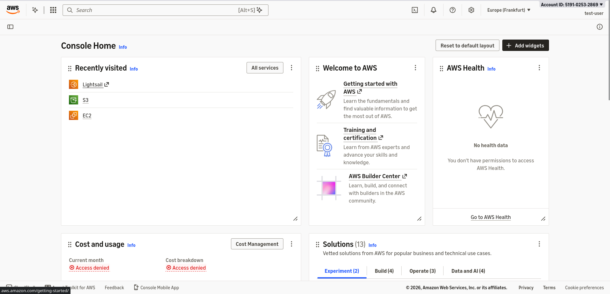
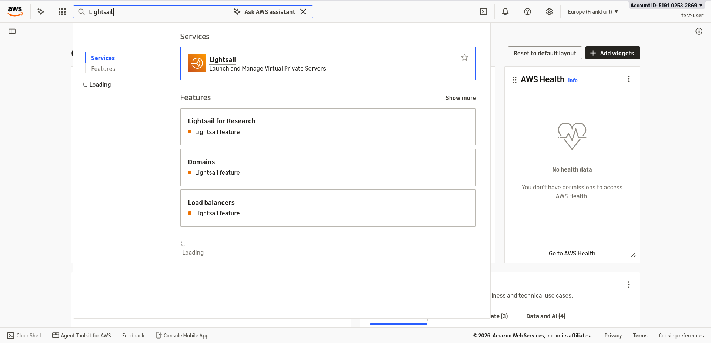
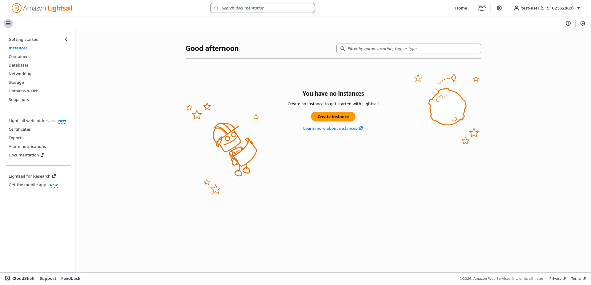
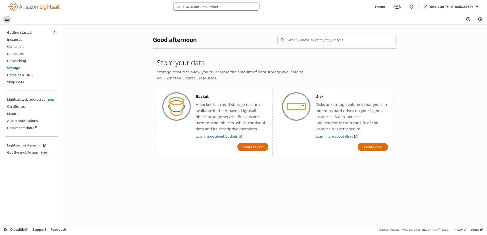

# Lightsail workshop: host a static website

Publish a static website using an Amazon Lightsail bucket and distribution. Visitors will see your homepage at an HTTPS address such as `https://abc123.cloudfront.net/`, without adding `/index.html`.

You will use the distribution's AWS-provided address. You do not need to buy a domain or configure DNS.

## Before you start

- Have an AWS account or the workshop sign-in details provided by your instructor.
- Use an identity with permission to manage Lightsail buckets and distributions.
- Prepare your HTML, CSS, JavaScript, and images, including a homepage named `index.html`.
- Use the Region and resource plans specified by your instructor, if provided.

**Cost:** Buckets and distributions are billable resources. Review the plans shown in the console and [Lightsail pricing](https://aws.amazon.com/lightsail/pricing/). Follow the cleanup steps when you finish.

## 1. Sign in to the AWS Management Console

Use the sign-in method supplied for your account.

### Workshop or organization access

1. Open the workshop [sign-in link](https://519102532869.signin.aws.amazon.com/console)
2. Sign in with the supplied credentials.

See [AWS sign-in URLs](https://docs.aws.amazon.com/signin/latest/userguide/sign-in-urls-defined.html) for help identifying your portal.

### IAM user access

1. Open the [AWS Management Console](https://console.aws.amazon.com/).
2. Choose the **IAM user** sign-in option if asked.
3. Enter your **account ID (519102532869)**, **IAM user name**, and **password**. 
4. Choose **Sign in** and complete MFA if enabled.

Your administrator may provide an account-specific URL that already includes the account ID. See [AWS IAM user sign-in instructions](https://docs.aws.amazon.com/signin/latest/userguide/introduction-to-iam-user-sign-in-tutorial.html).

**Checkpoint:** You can see Console Home. Check the account menu to confirm you are using the account assigned to the workshop.




## 2. Open the Lightsail dashboard

1. In the search bar at the top of the AWS console, enter `Lightsail`.
2. Select **Lightsail** from the service results.
3. Alternatively, open the [Lightsail console](https://lightsail.aws.amazon.com/) directly after signing in.



**Checkpoint:** The dashboard shows navigation options including **Storage** and **Networking**.

## 3. Prepare your website files

Keep `index.html` at the top level of the files you will upload. For example:

```
website/
    index.html
    css/
        styles.css
    images/
        logo.png
```

Upload the **contents** of `website/`, so the bucket contains `index.html`, `css/styles.css`, and `images/logo.png`. Uploading the enclosing folder would put your homepage at `website/index.html` instead.

If you do not have a website, save this example as `index.html` in a text editor. Ensure the filename is not `index.html.txt`.

```html
<!doctype html>
<html lang="en">
  <head>
    <meta charset="utf-8">
    <meta name="viewport" content="width=device-width, initial-scale=1">
    <title>My Lightsail website</title>
  </head>
  <body>
    <h1>Hello from Amazon Lightsail!</h1>
    <p>I published this static website during the workshop.</p>
  </body>
</html>
```

For a site generator, upload its generated website files. For MkDocs, these are the contents of the `site/` directory produced by `mkdocs build`.

## 4. Create a Lightsail bucket

A bucket stores your website files.

1. In Lightsail, choose **Storage** in the navigation pane.
2. Choose **Create bucket**.
3. Select the workshop's **AWS Region**, or one close to your audience.
4. Select the storage plan appropriate for the workshop.
5. Enter a name, such as `lightsail-workshop-yourname-1234`. If unavailable, choose another name.
6. Review your choices and choose **Create bucket**.
7. Open the bucket and leave its access permissions set to **All objects are private**.

Record the bucket name and Region for the distribution setup. See [AWS bucket creation instructions](https://docs.aws.amazon.com/lightsail/latest/userguide/amazon-lightsail-creating-buckets.html).




## 5. Upload your website

1. Open your bucket and choose the **Objects** tab.
2. At the top level of the object list, choose **Upload** and select your website files, or drag and drop them into the object list.
3. Include asset folders such as `css/` and `images/`, preserving their structure. Drag those folders into the object list if needed.
4. Wait until the uploads finish.
5. Confirm that `index.html` appears directly at the bucket's top level.

For example, `<link rel="stylesheet" href="css/styles.css">` requires an uploaded object at `css/styles.css`. File names and capitalization must match your HTML references. Upload extracted files rather than a ZIP archive.

See [AWS upload instructions](https://docs.aws.amazon.com/lightsail/latest/userguide/amazon-lightsail-uploading-files-to-a-bucket.html).

## 6. Create a distribution and set the homepage

A distribution fetches files from your bucket, caches them, and serves them to visitors.

1. Choose **Networking** in the Lightsail navigation pane.
2. Choose **Create distribution**.
3. Under **Choose your origin**, select your bucket's Region, then select the bucket.
4. Turn on **Enable private origin access** so the distribution can read the private files.
5. Under **Hosting settings**, set **Default root object** to exactly:

    ```
    index.html
    ```

6. Choose a distribution plan suitable for the workshop.
7. Enter a distribution name, such as `workshop-website`.
8. Leave optional custom domain or web address setup unused; the default distribution address is sufficient.
9. Review the settings and choose **Create distribution**.

**Do not skip the default root object.** It makes a request for `/` return your uploaded `index.html`. Enter the filename without a leading slash.

The bucket can remain private, but files served through the distribution are publicly accessible. Upload only content intended for publication. See [AWS's static website tutorial](https://docs.aws.amazon.com/lightsail/latest/userguide/amazon-lightsail-static-site-hosting-tutorial.html) and [distribution creation guide](https://docs.aws.amazon.com/lightsail/latest/userguide/amazon-lightsail-creating-content-delivery-network-distribution.html).

## 7. Test the website at its root URL

1. Open the distribution's management page.
2. Wait for its status to become **Deployed**. Refresh the page while deployment completes.
3. Find and copy the **Default domain**.
4. Open it in your browser with `https://` and a trailing `/`, for example:

    ```text
    https://abc123.cloudfront.net/
    ```

    This is an example; use the domain shown for your own distribution.

5. Confirm your homepage renders while the address ends at `/`, without `/index.html`.
6. Check that any styles, images, and links work too.

**Success:** Your homepage is available at the distribution's root URL. Share that HTTPS address with others.

## 8. Update your website

1. Edit your local files.
2. Upload the changed files to the same bucket paths, replacing existing objects when prompted.
3. On the distribution's management page, choose **Reset cache**.
4. After the reset completes, refresh your browser. Use a hard refresh if it still shows an older copy.

AWS covers cache resets and common errors in its [static website troubleshooting guide](https://docs.aws.amazon.com/lightsail/latest/userguide/amazon-lightsail-static-site-hosting-tutorial.html).

## Troubleshooting

| Problem | What to check |
| --- | --- |
| `/index.html` works, but `/` fails | Set **Default root object** to `index.html`, save any correction, and wait for deployment. |
| Access denied | Check that private origin access is enabled, the distribution is deployed, and `index.html` exists at the bucket's top level with matching capitalization. |
| Bucket missing from the origin list | Check the selected Region and AWS account. |
| Images or styles missing | Compare paths in your HTML with the uploaded folders and capitalization. |
| Old content appears | Reset the distribution cache, wait for completion, and hard refresh the browser. |
| AWS denies a console action | Ask your instructor or administrator to check your assigned permissions. |

## 9. Clean up after the workshop

Remove resources you no longer need to avoid ongoing charges. Keep local copies of files you want to retain.

1. In **Networking**, open your workshop distribution.
2. Choose the **Delete** tab, then **Delete distribution**, and confirm. Wait until deletion completes.
3. In **Storage**, open your workshop bucket.
4. Open the tab menu's **ellipsis (⋮)**, choose **Delete**, then **Delete bucket**.
5. Read and acknowledge the prompts, including the prompt about objects still in the bucket, and confirm deletion.
6. Confirm both workshop resources have been removed.

**Deleting the bucket permanently removes its contents, including stored object versions.** See AWS's instructions for [deleting a distribution](https://docs.aws.amazon.com/lightsail/latest/userguide/amazon-lightsail-deleting-distribution.html) and [deleting a bucket](https://docs.aws.amazon.com/lightsail/latest/userguide/amazon-lightsail-deleting-buckets.html).
